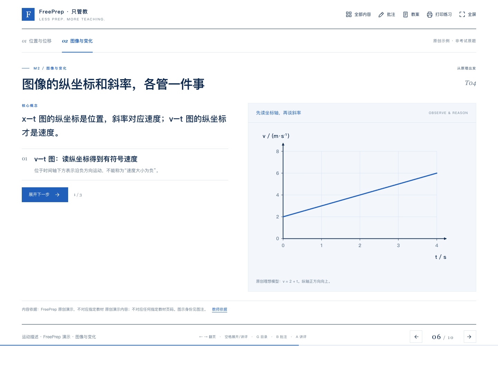

# FreePrep · 只管教

**把找教材、对课标、挑题、写解析、排课件交给 AI，让老师专注教学。**

FreePrep 是一个开放的备课 skill，附带可复用的 HTML 课件引擎。把教材、教学范围和你的要求交给支持 skills 的 AI 助手，按「课程依据 → 概念拆解 → 有据选题 → 完整解析 → 教学与视觉分镜 → 成品检查」完成材料，并持续吸收教师反馈。

[在线演示](https://ctri-y.github.io/freeprep/) · [安装与使用](#开始备课) · [工作流程](docs/workflow.md) · [贡献指南](CONTRIBUTING.md) · [English](README.en.md)



## 已经具备什么

- **以教材和官方要求为依据。** 区分文件版本、考试年、上传年、正文已读与候选链接。
- **围绕理解组织教学。** 保留必要推导、条件、反例和图示，避免只贴结论。
- **为每道题保留身份。** 原题、改编与原创明确区分，题尾可记录年份、地区和定位；原创数量由教师配置。
- **分层练习与完整解析。** 穿插提高题，计算题支持单独的题目图解和逐步计算页。
- **先分镜，再制作。** 每页记录教学目标、核心概念、公式、图示、逻辑、版式、视觉层级、首屏、逐步展开与结论。
- **拿到手就能上课。** 蓝白 HTML 支持缓变翻页、逐步展开、目录搜索、整页批注及导入导出、独立解析页和学生练习打印。

方法面向通用学科；目前经过教师多轮试用的是**初中与高中物理**。其他学科尚未完成同等程度的教学验证。公开小样包含 10 页、2 道明确标注的原创题，用于演示引擎，不是完整章节或真实考试题库。

## 开始备课

下载仓库后，把 `skills/freeprep` 整个文件夹安装到你的助手的 skill 目录。Codex 可使用 `$skill-installer` 安装：

```text
$skill-installer install https://github.com/ctri-y/freeprep/tree/main/skills/freeprep
```

也可以直接让助手阅读 `skills/freeprep/SKILL.md` 并使用其中的流程。支持情况和安装方式以你的助手为准；参见 [OpenAI 官方 skills 说明](https://learn.chatgpt.com/docs/build-skills)。

在备课工作区提供你合法持有的教材，发送：

```text
使用 $freeprep 为我准备教学材料。

学科与年级：高一物理
地区：江西
教材：人教版，以我提供的实际教材目录和内容为准
范围：第一大章全部内容
学生基础：偏弱，但需要从基本概念和原理讲透
节奏：整章备齐，我自行决定每次讲多少，不估算总课时
讲练原则：学生独立练习至少占一半，讲评不算独立练习
选题：优先可核验的教材、教辅或考试题；题尾标年份、地区和身份；原创最多 5 题
解析：必要计算题另设完整题目图解与计算页，简单题之间适当穿插提高题
交付：HTML 课件、学生练习、教师解析；不需要预习材料
风格：蓝白、简洁但信息充分；图文配合，必要推导不能省
先给我完整教学与视觉分镜，批准后再生成成品
```

这是一组可修改的示例偏好，不是所有用户的固定规则。后续可直接说「延续已确认标准，完成下一章并检查交付」。

FreePrep 本身不提供模型服务或自动购买题库。备课时，助手需要有读取材料、检索网络及生成文件的能力；相关模型或第三方服务可能收费。**打开、修改和构建已提供的演示无需 API key。**

## 运行演示与开发

需要 Node.js 22+、Python 3.10+。构建只用标准库，无需先安装 npm 依赖：

```sh
git clone https://github.com/ctri-y/freeprep.git
cd freeprep
npm run build
```

浏览器打开 `dist/index.html`，即可离线授课。配套分镜、来源台账和教师解析也会生成在 `dist/`。按 `←` / `→` 翻页，空格展开，`G` 打开目录，`B` 批注，`Esc` 返回浏览模式。

开发和浏览器回归检查：

```sh
npm ci
python3 -m pip install -r requirements-dev.txt
npx playwright install chromium
npm test
```

生成自己的课件：

```sh
python3 skills/freeprep/scripts/check_materials.py --course path/to/course.json
node skills/freeprep/scripts/build.mjs path/to/course.json --out output/index.html
```

课程结构见 [数据约定](docs/data-format.md) 与 [JSON Schema](schemas/course.schema.json)。扩展图示、公式和打印样式前，请阅读 [HTML 引擎说明](skills/freeprep/references/html-player.md)。

## 仓库结构

```text
skills/freeprep/       可单独安装的 skill、学科参考、检查脚本与 HTML 引擎
examples/motion/      原创演示课程 JSON，全部生成内容的单一来源
schemas/              课程数据的 JSON Schema
docs/                 工作流程、数据约定、截图与适用边界
tests/                来源约束、数值、批注、隐藏答案、图轴及移动端回归检查
.github/              自动检查、演示部署与问题模板
```

## 开源与材料范围

本仓库原创的 skill、代码、文档和演示采用 [MIT License](LICENSE)，允许商用、修改与再分发，需保留许可证及版权声明。

第三方教材、考试卷、教辅内容和图片的权利不因引用或改编而自动改变。本仓库不分发第三方整本教材、付费题库、学生记录或项目原始对话。自己生成材料时仍需记录来源并确认分发范围，见 [材料与许可说明](THIRD_PARTY.md)。

结构检查通过不能证明答案正确、课标有效或学生已经学会。教师仍需复核内容和实际课堂效果；当前能力边界见 [限制与后续方向](docs/limitations.md)。
